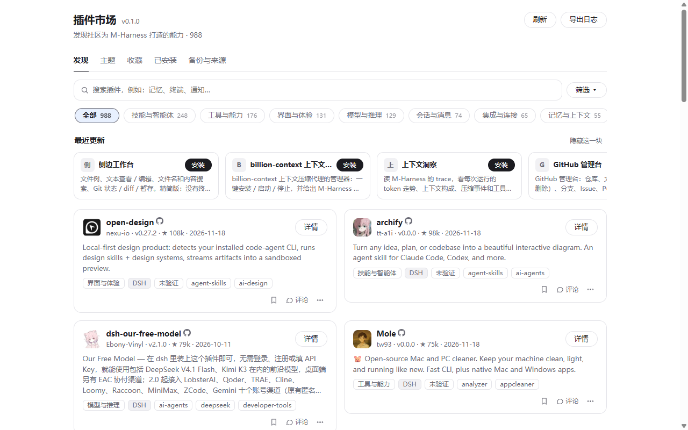

<p align="center"></p>

# M-Market

English | [中文](README.md)

[](https://github.com/1316584746/M-Market/actions/workflows/check.yml)
[](LICENSE)
[](https://github.com/1316584746/M-Market)

The **plugin market** for M-Harness, and its **official plugin repository**. Browse, search, one-click install.



> The screenshot shows the Plugin Market plugin inside M-Harness (Chinese UI): official DBX plugins plus the community DSH index, browsable by category, stars and recent updates.

## Install

M-Harness ships with this repository preset (Settings → Plugin repositories → "M-Harness official plugins"). Open the **Plugins** page, find **Plugin Market**, install it, then use it to install the rest.

If it is not preset, add this catalog URL as a plugin repository:

```
https://raw.githubusercontent.com/1316584746/M-Market/HEAD/catalog/index.json
```

The first time a plugin with a backend process runs, M-Harness asks you to trust it; a new version asks again.

**Requirement**: an M-Harness build that can start script backends (`desktop/main/pluginhost.ts` picks the bundled Node by file extension). Older builds can only launch native executables: these plugins install there but will not run.

## Official plugins

| Plugin | What it does | AI tools |
|---|---|---|
| **Plugin Market** (`market`) | Multi-source catalogs (DBX / DSH), search / categories / sorting, one-click install / update / uninstall, favorites, groups, notes, themes tab, backup and restore, diagnostics log | `market_search` `market_installed` `market_install` |
| **GitHub** (`github`) | Repositories, file browse and edit-commit, Issues, Pull Requests (diff / review / merge), Actions, Releases, branches; **includes write operations** | 8 read-only + 10 write tools (`github_issue_create` `github_pull_merge` `github_file_write` …) |
| **MemSearch** (`memsearch`) | Long-term memory as Markdown, offline keyword (BM25) search, mountable note folders | `memory_search` `memory_recent` `memory_add` |
| **Context Insight** (`context-insight`) | Reads M-Harness traces: token trend, context composition, compaction events, tool-output usage | `context_runs` `context_stats` |
| **billion-context** (`billion-context`) | Manager for the [billion-context](https://github.com/ranxianglei/billion-context) compression proxy: install / start / stop, per-provider proxy URLs | — |
| **Better Sidebar** (`better-sidebar`) | File tree, view / edit, name and content search, Git status / diff / stage | — |

All six are **one package for all three platforms**: the backend is a Node script (`.cjs`) run by the Node bundled with M-Harness; nothing is compiled per OS.

## What the market does

- **Browse & search** the DBX catalog and the DSH market index together; category pills with counts, sort by stars / recent / name, type and source filters, a "Recently updated" strip
- **One-click install / update / uninstall** (DBX plugins): permissions are shown first; the download is checked against the catalog sha256 and the in-package `checksums.json`; downloads are restricted to the catalog's own host and a few common hosts
- **Screenshots**: used as listed in the catalog, otherwise picked from the plugin repository README (GitHub-hosted images only; badges and other hosts are dropped), shown as a carousel in the detail view
- **Favorites, groups, notes**: stored locally only; notes are searchable
- **Themes tab**: plugins whose name or keywords mention theme / skin
- **Backup & restore**: readable JSON, WebDAV, or a private Gist; restore merges by default
- **Export log**: versions, source status, installed plugins; paths and tokens are masked, nothing is sent anywhere
- **AI tools**: `market_search` / `market_installed` / `market_install`

### How it differs from DSH Market (honestly)

This market was **rewritten after [dsh-market](https://github.com/dsh-market/dsh-market)**: the layout and scope follow it, but it is not a port and has far fewer features:

- **Comments**: a plugin window cannot embed giscus (the sandbox blocks external frames). The "Comments" button gives the plugin repository's Discussions / Issues links to open in a browser.
- **DSH plugins are browse-only**: M-Harness exposes no install API; the market downloads, verifies and extracts into `plugins/` itself, and only knows DBX packages. Install DSH plugins from M-Harness's own plugin center.
- **Missing**: download statistics, compatibility filter, hot disable / enable, background update reminders (cards only show "update available"), load-order and conflict diagnostics, blocking, GitHub acceleration routes.
- Screenshots on **cards** only appear for catalog entries that declare `screenshots`; README-derived images show in the detail view only.

## Website

`.github/workflows/site.yml` fetches the upstream DSH market index daily, merges it with this repository's official plugins, builds a searchable static site (`site/` is the template) and publishes it to GitHub Pages. Set **Settings → Pages → Source** to **GitHub Actions** once. If the upstream is unreachable, only official plugins are published; the build does not fail.

## Security

- Packages are verified against the catalog sha256 and the in-package `checksums.json`; extraction rejects `..` and absolute paths
- Downloads must be https (loopback excepted) and come from the catalog's host or `raw.githubusercontent.com` / `github.com` / `objects.githubusercontent.com` / `cdn.jsdelivr.net` / `dl.dbxio.com`
- Plugin UIs run in a sandboxed iframe; network access is limited to the origins declared as `host.network:` in the manifest
- **Tokens and passwords are stored in plain text** in the plugin's data directory (the sandbox has no keychain): the market's WebDAV password / Gist token and the GitHub plugin's personal access token. Use minimal-scope fine-grained tokens. Backups never contain them.
- The GitHub plugin's AI write tools change your repositories for real; do not enable them if you do not want the AI to act
- Listed does not mean endorsed: plugins are third-party code

See [SECURITY.md](SECURITY.md) to report a vulnerability.

## Submit your plugin

- **Into this repository**: PRs welcome. Build it as described below, run `node scripts/pack.mjs`, and open a PR with the template.
- **In your own repository**: publish a DBX catalog (`catalog/index.json`, same format as here) and add its URL as a source in the market's "Backup & sources" tab.
- Bugs go to [issues](https://github.com/1316584746/M-Market/issues); attach the market's "Export log".

## Layout

```
catalog/index.json      DBX catalog (generated by scripts/pack.mjs)
packages/*.dbxp         packages (generated; marked binary in .gitattributes)
plugins/<id>/           plugin sources (manifest.json, bin/backend.cjs, ui/, assets/)
shared/rpc.cjs          shared JSON-RPC helper (copied into each package as bin/rpc.cjs)
scripts/                pack.mjs, build-site.mjs, dev-ui.mjs
site/                   static website template
assets/                 images for the README
test/                   behaviour tests
```

## Development

Node ≥ 20, no dependencies.

```bash
node scripts/pack.mjs           # build all packages, update catalog/index.json
node scripts/pack.mjs --check   # verify packages and catalog match the sources (CI)
node --test test/*.test.mjs     # tests run against the published packages in packages/
node scripts/dev-ui.mjs market  # debug a plugin UI in a normal browser
```

After changing a plugin: bump `version` in its `manifest.json`, run `node scripts/pack.mjs`, commit sources, `packages/` and `catalog/`. Without a version bump, installed users receive no update.

## License

Repository code is MIT. Each plugin's `NOTICE.md` lists the upstream projects it drew on and their licenses.
